# 🏙️ SmartCity.ai – Autonomous Civic OS & Public Works Audit Platform

[](https://mongodb.com)
[](https://ai.google.dev/)
[](https://react.dev/)
[](https://leafletjs.com/)
[](https://cloudinary.com/)
[](https://www.mongodb.com/atlas)
[](LICENSE)

> **Empowering citizens and municipal corporations with AI-driven defect verification, real-time GIS hazard tracking, localized infrastructure health analytics, and public works contract transparency.**

---

## 📑 Table of Contents

- [The Problem Statement](#-the-problem-statement)
- [What SmartCity.ai Solves](#-what-smartcityai-solves)
- [How It Solves the Problem: End-to-End Workflow](#-how-it-solves-the-problem-end-to-end-workflow)
- [How It Helps Real-World Users](#-how-it-helps-real-world-users)
- [System Architecture & Data Flow](#-system-architecture--data-flow)
- [Comprehensive Folder Structure](#-comprehensive-folder-structure)
- [Core Feature Highlights](#-core-feature-highlights)
- [Role-Based Access Control (RBAC)](#-role-based-access-control-rbac)
- [REST API Reference](#-rest-api-reference)
- [Local Development Setup](#-local-development-setup)
- [Automated Testing & Verification](#-automated-testing--verification)
- [Production Deployment Guide](#-production-deployment-guide)

---

## 🛑 The Problem Statement

Rapid urbanization has placed enormous pressure on municipal infrastructure. However, the systems handling public grievances and municipal works suffer from deep systemic breakdowns:

```
    [Citizen Spots Hazard] ──► [Bureaucratic Silence] ──► [Lost Complaints] ──► [Road Collapse / Accidents]
                                        ▲
    [Public Works Tender]  ──► [Zero Transparency]     ──► [Inflated Costs]  ──► [No Warranty Accountability]
```

1. **Civic Black Holes & Public Apathy**:
   Citizens report hazardous potholes, broken water mains, open manholes, or street lighting failures, only for their complaints to sit unassigned in bureaucratic backlogs without feedback, status updates, or accountability.
2. **Spam & Vague Submissions Overwhelming Staff**:
   Traditional civic portals receive thousands of low-quality submissions—memes, blurry images, food photos, or vague notes without exact coordinates—wasting municipal field hours manually triaging claims.
3. **Public Works Opacity & Budget Inflation**:
   Millions in public taxpayer funds are sanctioned for road resurfacing and stormwater drain repairs, but citizens have no visibility into contractor identities, line-item budgets, completion deadlines, or mandatory defect liability warranties.
4. **Lack of Legal & Administrative Teeth**:
   When defects are ignored, ordinary citizens lack the legal knowledge to draft formal administrative notices or Right-to-Information (RTI) complaints to hold department heads liable.
5. **Reactive Rather Than Predictive Maintenance**:
   Municipalities only dispatch repair crews *after* catastrophic failures or viral public outrage occur, rather than detecting clustered deterioration patterns before disasters strike.

---

## 💡 What SmartCity.ai Solves

**SmartCity.ai** transforms civic administration from a slow, opaque complaint box into an **intelligent, automated, citizen-powered Civic Operating System (OS)**.

| The Problem | How SmartCity.ai Solves It |
| :--- | :--- |
| **Fake / Spam Submissions** | Multi-modal AI Vision (**Gemini 2.5 Flash**) inspects images at the binary and semantic level, instantly verifying genuine civic hazards and rejecting irrelevant photos. |
| **Vague defect descriptions** | AI auto-diagnoses the hazard, assigns an engineering priority score (1–10), classifies severity (`critical`, `high`, `moderate`), and drafts technical descriptions with speech-to-text voice dictation. |
| **Missing location data** | 1-click GPS detection with OpenStreetMap Nominatim reverse geocoding translates raw latitude/longitude into complete street, neighborhood, and city addresses. |
| **No repair guidance** | Every report automatically generates a public, step-by-step **Engineering Remediation Action Plan** (e.g., Traffic Diversion, Cavity Cleaning, Bituminous Compaction). |
| **Ignored grievances** | Original reporters can generate a pre-formatted, legal-grade **Official RTI Grievance Letter** addressed to the specific department head with 1 click. |
| **Tender corruption & waste** | The **Public Works Tender Monitor** breaks down sanctioned budgets into line items and runs an **AI Engineering Feasibility Audit** against CPWD/PWD standard rates, allowing citizens to file dispute observations directly against active contracts. |
| **City-wide blind spots** | An interactive GIS map with a tactile **3D "Locate 5km Around Me"** radar, dynamic **Area Health Indices (0–100)**, and predictive **AI Municipal Outlooks** with **Monsoon Weather Stress Simulation**. |

---

## 🔄 How It Solves the Problem: End-to-End Workflow

```mermaid
flowchart TD
    A[Citizen Snaps Hazard Photo] --> B[Client-Side Compression]
    B --> C[Google Gemini AI Vision Verification]
    C -->|Invalid / Spam| D[Immediate Rejection with Clear Reason]
    C -->|Verified Hazard| E[AI Diagnostics & Severity Scoring]
    E --> F[GPS + Reverse Geocoding via Nominatim]
    F --> G[Cloudinary CDN Image Storage]
    G --> H[MongoDB Atlas Geo-Incident Record]
    H --> I[Public GIS Incident Map & 5km Radar]
    H --> J[Engineering Remediation Plan Generated]
    H --> K[Localized Area Health Index Recalculated]
    H --> L[AI Municipal Outlook & Cluster Prediction]
    H --> M[1-Click Official RTI / Municipal Grievance Directive]
```



1. **Snap & Authenticate**: A citizen snaps an on-site photo. Gemini AI inspects the pixels, verifying whether the image depicts a genuine roadway, sanitation, electrical, or water defect.
2. **Geolocate**: The device GPS captures exact coordinates, and the server resolves the exact street, ward, and city jurisdiction.
3. **AI Triage & Public Remediation Checklist**: Gemini assigns priority (1–10), identifies the responsible municipal department, and crafts a technical repair protocol visible to the public.
4. **Live GIS Radar & Health Index**: The defect appears on the interactive Leaflet map. The localized **Area Health Index (0–100)** instantly updates, deducting points for open critical hazards.
5. **Predictive Outlook & Hotspot Analysis**: AI analyzes spatial clusters to forecast severe road collapses, allowing municipal engineers to zoom directly to hotspots and dispatch preventative crews.
6. **Tender Accountability**: If a defect occurs on a recently resurfaced road, citizens cross-reference the **Public Works Tender Monitor**, review the contractor's warranty liability period, and submit a formal dispute or RTI audit.

---

## 👥 How It Helps Real-World Users

### 🚶 For Everyday Citizens & Commuters
- **Frictionless 60-Second Reporting**: Upload a photo, speak using voice dictation, let AI fill in the technical specifics, and confirm with 1 tap.
- **Live 5 km Hazard Radar**: Tap the tactile 3D **"Locate 5km Around Me"** button to view every dangerous pothole, unlit street, or open manhole within walking/driving distance.
- **1-Click RTI Grievance Letters**: Generate a formal legal complaint letter to hold municipal ward officers accountable without hiring a lawyer.
- **Contractor Watchdog**: Check if the road in front of your house is under a contractor defect liability warranty before paying for local repairs.

### 👷 For Municipal Engineers & PWD Crews
- **Zero Spam Overhead**: Every ticket is pre-validated by AI with authentic photographs, GPS pins, and categorized severity.
- **Actionable Work Orders**: Instead of "road broken", engineers receive structured repair protocols: **Traffic Diversion ➔ Debris Clearance ➔ Tack Coat Application ➔ Dense Bituminous Macadam Compaction**.
- **Transparent Verification**: Field teams upload post-repair verification photos to mark issues resolved and restore community health scores.

### 🏛️ For City Administrators & Municipal Commissioners
- **Live Municipal Vital Signs**: Real-time **Area Health Index (0–100)** gives mayors and commissioners a single quantitative benchmark of ward performance.
- **Predictive Disaster Mitigation**: The **AI Municipal Outlook** flags emerging hazard clusters before heavy rains cause catastrophic washouts.
- **Monsoon Stress Simulation**: Toggle the **Rain Model** to simulate precipitation impact on road cavitation and pre-emptively desilt stormwater drains.

### 🔍 For Civil Society, RTI Activists & Taxpayers
- **Open Tender Audits**: Inspect public works tenders with sanctioned budgets, contractor assignments, and line-item cost shares.
- **AI Feasibility Benchmarks**: Identify bloated budgets or questionable cost variances flagged against official civil engineering Schedule of Rates.
- **Community Dispute Lodging**: File evidence-backed audit observations to trigger independent departmental inspections.

---

## 🏛️ System Architecture & Data Flow

```
┌────────────────────────────────────────────────────────────────────────┐
│                        CLIENT LAYER (React 18 + Vite)                  │
│  ┌────────────────────┐  ┌──────────────────┐  ┌────────────────────┐  │
│  │  Interactive GIS   │  │  AI Issue Wizard │  │  Tender Audit Hub  │  │
│  │ (Leaflet + Layers) │  │  (Camera/Voice)  │  │  (Budget Feas.)    │  │
│  └─────────┬──────────┘  └─────────┬────────┘  └─────────┬──────────┘  │
└────────────┼───────────────────────┼─────────────────────┼─────────────┘
             │                       │                     │
             ▼                       ▼                     ▼
┌────────────────────────────────────────────────────────────────────────┐
│                       SERVER LAYER (Node.js + Express)                 │
│  ┌──────────────────────────────────────────────────────────────────┐  │
│  │  Security Middleware: Helmet, CORS, Rate Limiters, JWT Cookies   │  │
│  └─────────────────────────────────┬────────────────────────────────┘  │
│                                    │                                   │
│  ┌─────────────────────────────────┴────────────────────────────────┐  │
│  │  RESTful API Controllers: /reports, /tenders, /disputes, /stats  │  │
│  └─────────────┬───────────────────┬───────────────────┬────────────┘  │
└────────────────┼───────────────────┼───────────────────┼───────────────┘
                 │                   │                   │
                 ▼                   ▼                   ▼
┌───────────────────────┐  ┌───────────────────┐  ┌────────────────────┐
│   Google Gemini AI    │  │  Cloudinary CDN   │  │   MongoDB Atlas    │
│  (gemini-2.5-flash)   │  │  (Image Hosting)  │  │ (GeoJSON & Schemas)│
└───────────────────────┘  └───────────────────┘  └────────────────────┘
```

---

## 📂 Comprehensive Folder Structure

```text
smart-city-mern/
├── client/                               # Frontend Single-Page Application (React + Vite)
│   ├── public/                           # Static public assets and web icons
│   ├── src/
│   │   ├── components/                   # Reusable UI & specialized feature components
│   │   │   ├── AuthModal.jsx             # Inline login & registration dialog
│   │   │   ├── CameraModal.jsx           # Live webcam / device camera snapshot interface
│   │   │   ├── DisputeForm.jsx           # Form for lodging citizen observations against tenders
│   │   │   ├── Footer.jsx                # Responsive platform footer with civic disclaimers
│   │   │   ├── LocationPicker.jsx        # Interactive Leaflet pin-drop coordinate selector
│   │   │   ├── Modal.jsx                 # Generic accessible backdrop & modal wrapper
│   │   │   ├── Navbar.jsx                # High z-index navbar with responsive mobile profile menu
│   │   │   ├── ReportAnalysisModal.jsx   # Detailed modal displaying AI triage & action plans
│   │   │   ├── ReportCard.jsx            # Interactive card with address, upvote, & RTI letter
│   │   │   ├── ReportsMap.jsx            # Leaflet GIS map with custom pins & 5km radar circle
│   │   │   ├── RequireRole.jsx           # Role-based route guard for protected endpoints
│   │   │   ├── TenderModal.jsx           # Modal displaying line-item budget & AI feasibility
│   │   │   ├── Toast.jsx                 # Real-time animated notification banner system
│   │   │   └── VoiceInputButton.jsx      # Speech-to-text dictation button (Web Speech API)
│   │   ├── pages/                        # Primary top-level route views
│   │   │   ├── Admin.jsx                 # Municipal officer dashboard for ticket moderation
│   │   │   ├── Home.jsx                  # Public landing portal with hero & feature highlights
│   │   │   ├── Login.jsx                 # Full-page authentication view
│   │   │   ├── MapPage.jsx               # City Issues Map, Area Health Index & AI Outlook
│   │   │   ├── Report.jsx                # 4-step civic issue submission wizard
│   │   │   └── Tenders.jsx               # Public Works Tender Monitor and audit explorer
│   │   ├── utils/                        # Frontend helpers & utilities
│   │   │   ├── format.js                 # Currency (₹ Lakhs/Crores), dates, & status styling
│   │   │   ├── geocode.js                # Nominatim reverse geocoding & Haversine distance
│   │   │   └── resizeImage.js            # Client-side canvas image compression
│   │   ├── api.js                        # Axios/Fetch API wrapper with retry logic & CSRF
│   │   ├── App.jsx                       # Master client router and layout wrapper
│   │   ├── AuthContext.jsx               # Context provider managing session state & roles
│   │   ├── main.jsx                      # React 18 application entry point
│   │   └── styles.css                    # Tailwind CSS definitions, 3D button animations
│   ├── index.html                        # HTML5 document template
│   ├── package.json                      # Client dependencies and Vite scripts
│   └── vite.config.js                    # Vite bundler configuration & local API proxy
│
├── server/                               # Backend RESTful API (Node.js + Express)
│   ├── src/
│   │   ├── config/                       # Core system configurations
│   │   │   ├── db.js                     # MongoDB Atlas Mongoose connection pool
│   │   │   └── env.js                    # Environment validation using Zod schemas
│   │   ├── middleware/                   # Express HTTP pipeline middleware
│   │   │   ├── auth.js                   # JWT cookie verification & RBAC authorization
│   │   │   ├── error.js                  # Centralized error handler and HTTP error mapper
│   │   │   ├── limits.js                 # IP rate limiting (express-rate-limit)
│   │   │   └── upload.js                 # Multer memory storage & magic bytes filter
│   │   ├── models/                       # MongoDB Mongoose data schemas
│   │   │   ├── Dispute.js                # Citizen observations against municipal contracts
│   │   │   ├── Report.js                 # Civic defects with GPS coordinates & AI triage
│   │   │   ├── Tender.js                 # Public works contracts with line-item budgets
│   │   │   └── User.js                   # User accounts with bcrypt hashing & roles
│   │   ├── routes/                       # Express RESTful route definitions
│   │   │   ├── auth.js                   # User registration, login, logout, and profile
│   │   │   ├── disputes.js               # Citizen tender disputes retrieval and moderation
│   │   │   ├── reports.js                # Issue intake, AI verification, upvoting, & status
│   │   │   ├── stats.js                  # Municipal health scores & predictive outlook
│   │   │   └── tenders.js                # Tender catalog, AI feasibility audit, & filing
│   │   ├── scripts/                      # Database maintenance & CLI utilities
│   │   │   ├── seed.js                   # Mock data seeder with tenders and geo-reports
│   │   │   └── setRole.js                # CLI utility to grant `authority` or `admin` roles
│   │   ├── services/                     # Business logic and external API integrations
│   │   │   ├── cloudinary.js             # Cloudinary asset upload & transformation
│   │   │   ├── gemini.js                 # Google Gemini 2.5 Flash orchestration
│   │   │   ├── health.js                 # Deterministic Area Health Index algorithms
│   │   │   └── letters.js                # Formal RTI grievance complaint templates
│   │   ├── utils/                        # Backend helper functions
│   │   │   ├── HttpError.js              # Standardized HTTP error class
│   │   │   ├── image.js                  # Magic bytes inspection (JPEG/PNG/WEBP)
│   │   │   └── sanitize.js               # AI JSON schema sanitization & clip guards
│   │   ├── app.js                        # Express application factory & security suite
│   │   └── index.js                      # HTTP server bootstrap & graceful shutdown
│   ├── tests/                            # Automated backend test suite (node:test)
│   │   ├── complaint.test.js             # Validates RTI complaint generation formatting
│   │   ├── health.test.js                # Tests deterministic health scoring formulas
│   │   ├── image.test.js                 # Tests magic bytes detection & XSS rejection
│   │   └── tender.test.js                # Tests budget feasibility math & share sums
│   └── package.json                      # Server dependencies and test scripts
│
├── .gitignore                            # Git exclusion rules (node_modules, .env, dist)
└── README.md                             # Comprehensive project documentation
```

---

## ⚡ Core Feature Highlights

### 1. 🔍 AI Vision Verification & Triage
- **Multi-Modal Verification**: Analyzes uploaded photos using Google Gemini 2.5 Flash to verify that the image represents a legitimate civic hazard.
- **Anti-Spam Filter**: Non-civic uploads (landscapes, pets, food, memes) are rejected immediately with a friendly explanation.
- **Intelligent Auto-Tagging**: Detects potholes, streetlights, drainage blockages, water pipe ruptures, and garbage dumps with priority scoring (1–10).

### 2. 🗺️ Interactive GIS Map & 3D 5km Radar
- **Multi-Layer Leaflet Map**: Switch seamlessly between **OpenStreetMap Standard**, **Satellite Imagery**, **Carto Dark Mode**, and **Topographic Terrain**.
- **Tactile 3D "Locate 5km Around Me" Button**: A single tap activates GPS tracking, creates an animated 5-kilometer perimeter circle on the map, and filters the live incident feed strictly to your neighborhood.
- **Top City Selector**: Effortlessly switch scopes across all detected cities or view the national aggregate.

### 3. 📈 Localized Area Health Index (0–100)
- **Quantitative Municipal Vital Sign**: Computes a dynamic score derived from open vs. resolved hazards:
  $$\text{Score} = \max(0, \min(100, 100 - 15 \times \text{Critical} - 8 \times \text{High} - 2 \times \text{Moderate}))$$
- **Interactive Score Impact Badges**: Clicking `🔴 -15 pts (Critical)` immediately filters the map and feed to show the exact hazards hurting your community's vital score.
- **Transparent Formula Breakdown**: An expandable toggle demystifies how points are deducted and how resolved issues restore community health.

### 4. 🧠 AI Municipal Outlook & Rain Model
- **Predictive Hazard Analytics**: Groups geographic reports to spot root causes (e.g., repeated water pipe leakage undermining road sub-bases).
- **🎯 1-Click "Zoom to Hotspot"**: Auto-flies the map camera directly to the AI-predicted hazard cluster with zoom level 15.
- **📄 "Draft Grievance Letter"**: Generates a pre-formatted administrative memorandum addressed to the Municipal Commissioner and PWD.
- **🌧️ "Rain Model" Simulation**: Toggles monsoon stress modeling, illustrating how heavy rains accelerate cavitation in low-lying zones.

### 5. 📋 Public Works Tender Monitor
- **Contract Ledger**: Search and inspect municipal tenders by department, contractor, budget, and defect liability warranty.
- **Line-Item Breakdown**: Splits sanctioned amounts into actionable engineering components (e.g. Bituminous Overlay, Silt Traps, RCC Culverts).
- **AI Feasibility Audit**: Compares estimates against official civil engineering schedules of rates and classifies contracts as:
  - `within_benchmark`: Cost aligns with standard municipal engineering norms.
  - `flagged_variance`: Specific budget allocations appear unusually inflated.
  - `human_audit_needed`: Quantities are ambiguous, requiring an independent engineering audit.
- **Citizen Dispute Filing**: Allows community members to submit on-site observations directly linked to active public contracts.

---

## 🔐 Role-Based Access Control (RBAC)

SmartCity.ai enforces strict permissions across three user personas:

| Action / Capability | Citizen (`citizen`) | Authority (`authority`) | Administrator (`admin`) |
| :--- | :---: | :---: | :---: |
| **Submit Civic Reports (AI Verified)** | ✅ | ✅ | ✅ |
| **View GIS Map & 5km Radar** | ✅ | ✅ | ✅ |
| **Upvote Community Issues** | ✅ | ✅ | ✅ |
| **Generate Personal RTI Letters** | ✅ *(Own Reports)* | ✅ *(Own Reports)* | ✅ *(All Reports)* |
| **Inspect Public Works Tenders** | ✅ | ✅ | ✅ |
| **File Observations on Contracts** | ✅ | ✅ | ✅ |
| **Publish Official Tenders** | ❌ | ✅ | ✅ |
| **Update Incident Status (In Progress/Resolved)** | ❌ | ✅ | ✅ |
| **Moderate Citizen Contract Disputes** | ❌ | ❌ | ✅ |
| **CLI Role Assignment** | ❌ | ❌ | ✅ *(Terminal Only)* |

---

## 📡 REST API Reference

All protected endpoints require a signed HTTP-only JWT authentication cookie (`token`).

<details>
<summary><b>Click to expand REST Endpoints</b></summary>

### Authentication (`/api/auth`)
- `POST /api/auth/register` – Register a new citizen account
- `POST /api/auth/login` – Authenticate user and receive signed cookie
- `POST /api/auth/logout` – Clear session cookie
- `GET /api/auth/me` – Retrieve current authenticated user profile

### Civic Reports (`/api/reports`)
- `GET /api/reports` – Retrieve list of public civic incidents (supports search & filters)
- `POST /api/reports` – Submit a new report (multipart/form-data with photo verification)
- `POST /api/reports/:id/vote` – Toggle community upvote on an incident
- `PATCH /api/reports/:id/status` – Update ticket status (Requires `authority` or `admin`)
- `GET /api/reports/:id/complaint` – Generate formal RTI grievance letter (Author only)

### Public Tenders & Audits (`/api/tenders`)
- `GET /api/tenders` – List public tenders with line-item budgets and status
- `POST /api/tenders` – Create a new public works tender (Requires `authority` or `admin`)
- `GET /api/tenders/:id/breakdown` – Retrieve AI cost feasibility breakdown
- `POST /api/tenders/:id/disputes` – Submit citizen observation/dispute on a contract

### Civic Analytics (`/api`)
- `GET /api/stats` – Aggregated statistics and live Area Health Index
- `GET /api/predictions` – Cached predictive AI Municipal Outlook & hotspot telemetry
- `GET /api/health` – Server health status probe

</details>

---

## 🛠️ Local Development Setup

### Prerequisites
- [Node.js](https://nodejs.org/) v20.x or higher
- [MongoDB Atlas](https://www.mongodb.com/atlas) cluster connection URI (or local MongoDB)
- [Cloudinary](https://cloudinary.com/) account (Cloud Name, API Key, API Secret)
- [Google AI Studio](https://aistudio.google.com/) Gemini API Key

---

### Step 1: Clone the Repository
```bash
git clone https://github.com/RaviKumarYadav15/capstone3-smartCity_ai.git
cd smart-city-mern
```

---

### Step 2: Configure & Start the Backend

1. Navigate to the `server` directory and install dependencies:
   ```bash
   cd server
   npm install
   ```

2. Create a `server/.env` file:
   ```env
   PORT=5000
   NODE_ENV=development
   MONGODB_URI=mongodb+srv://<username>:<password>@cluster0.xxxxx.mongodb.net/smartcity?retryWrites=true&w=majority
   JWT_SECRET=super_secure_random_jwt_secret_key_at_least_32_characters
   CLIENT_ORIGIN=http://localhost:5173
   GEMINI_API_KEY=your_gemini_api_key_here
   GEMINI_MODEL=gemini-2.5-flash
   CLOUDINARY_CLOUD_NAME=your_cloudinary_cloud_name
   CLOUDINARY_API_KEY=your_cloudinary_api_key
   CLOUDINARY_API_SECRET=your_cloudinary_api_secret
   COOKIE_SECURE=false
   TRUST_PROXY=false
   ```

3. Seed initial municipal tenders and test users:
   ```bash
   npm run seed
   ```
   *Seeded demo accounts:*
   - **Admin**: `admin@smartcity.test` (Password: `Passw0rd!demo`)
   - **Authority**: `authority@smartcity.test` (Password: `Passw0rd!demo`)
   - **Citizen**: `citizen@smartcity.test` (Password: `Passw0rd!demo`)

4. Start the backend development server:
   ```bash
   npm run dev
   ```
   *The server runs on `http://localhost:5000`.*

---

### Step 3: Configure & Start the Frontend

1. In a new terminal, navigate to the `client` directory:
   ```bash
   cd client
   npm install
   ```

2. Start the Vite development server:
   ```bash
   npm run dev
   ```
   *The client runs on `http://localhost:5173` (Vite automatically proxies `/api` calls to port 5000).*

---

### Step 4: Role Promotion Helper (CLI)

To promote any registered user to an `authority` or `admin`, run the set-role script from the `server` directory:

```bash
cd server
npm run set-role -- user@example.com admin
```

---

## 🧪 Automated Testing & Verification

SmartCity.ai includes a rigorous automated test suite built on the native Node.js test runner (`node:test`):

```bash
cd server
npm test
```

### What the test suite covers:
- **Health Index Determinism**: Ensures penalty weights match formula bounds and clamp between 0–100.
- **Image Security & Magic Bytes**: Verifies genuine JPEG, PNG, and WebP signatures while rejecting HTML, SVG, and disguised scripts.
- **Tender Math Integrity**: Validates line-item calculations, component sum constraints, and budget percentages.
- **RTI Template Compliance**: Guarantees legal complaints contain accurate dates, departmental addresses, and coordinates.
- **AI Schema Sanitization**: Asserts that all Gemini prediction outputs match strict fallback shapes even during service outages.

Test client production compilation:
```bash
cd client
npm run build
```

---

## 🚀 Production Deployment Guide

The recommended production architecture utilizes **Render** for the persistent Node.js API and **Vercel** for the edge-optimized React frontend.

### 1. Deploy Backend on Render (Web Service)
1. Create a **New Web Service** connected to your GitHub repository.
2. Root Directory: `server`
3. Build Command: `npm install`
4. Start Command: `npm start`
5. Configure Environment Variables:
   - `NODE_ENV`: `production`
   - `PORT`: `10000`
   - `MONGODB_URI`: `<Your MongoDB Atlas Connection String>`
   - `JWT_SECRET`: `<Random 32+ Character Secret>`
   - `CLIENT_ORIGIN`: `https://your-smartcity-app.vercel.app`
   - `CLOUDINARY_CLOUD_NAME`: `<Cloud Name>`
   - `CLOUDINARY_API_KEY`: `<API Key>`
   - `CLOUDINARY_API_SECRET`: `<API Secret>`
   - `GEMINI_API_KEY`: `<Gemini API Key>`
   - `GEMINI_MODEL`: `gemini-2.5-flash`
   - `COOKIE_SECURE`: `true`
   - `TRUST_PROXY`: `true`

### 2. Deploy Frontend on Vercel
1. Create a **New Project** on Vercel importing the repository.
2. Root Directory: `client`
3. Framework Preset: `Vite`
4. Add Environment Variable:
   - `VITE_API_URL`: `https://your-smartcity-api.onrender.com` (no trailing slash)
5. Click **Deploy**.

---

## 📄 License

Distributed under the **MIT License**. See `LICENSE` for more information.

---

<div align="center">
  <sub>Built with ❤️ by the SmartCity.ai Team for transparent, responsive, and accountable cities.</sub>
</div>
